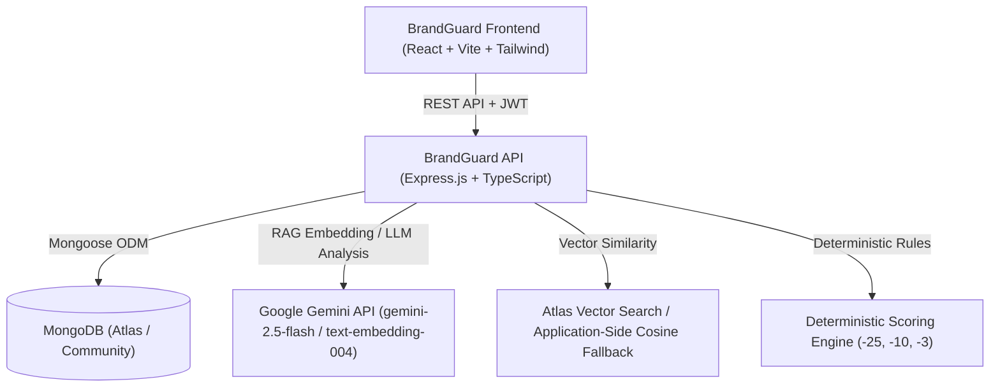

# BrandGuard AI Architecture Documentation

## System Vision
**Tagline:** Create Freely. Publish Confidently.
BrandGuard AI is an AI-powered Brand Governance and Content Compliance Platform acting as an intelligent checkpoint between content creation and publication.

## Core System Architecture

## Core Governance Lifecycle

1. **Submission**: Content Creator submits marketing copy.
2. **Claim Extraction**: Multi-category claim detector isolates factual, product, and promotional claims.
3. **RAG Semantic Retrieval**: System searches indexed brand document chunks for corroborating evidence.
4. **Claim Verification**: Claims are matched against RAG evidence, Approved Facts, and Restricted Claims, categorized as `SUPPORTED`, `CONTRADICTED`, `UNSUPPORTED`, or `AMBIGUOUS`.
5. **Tone & Terminology Check**: Content is evaluated against voice guidelines and prohibited/preferred vocabulary.
6. **Deterministic Scoring**: Compliance score calculated out of 100 with strict deduplication.
7. **Explainable Corrections**: Actionable drop-in replacements generated with rationale.
8. **Creator Revision & Revalidation**: Revised content is re-analyzed in full.
9. **Human Review & Approval**: Authorized reviewers inspect findings, leave feedback, and approve/reject. AI never auto-publishes.

## Tenant Isolation & Security
- Every collection item contains `organisationId`.
- Middleware `enforceOrgIsolation` blocks any cross-tenant data access.
- Creators are prevented from approving their own submissions.
